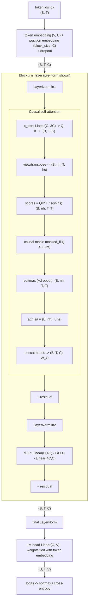
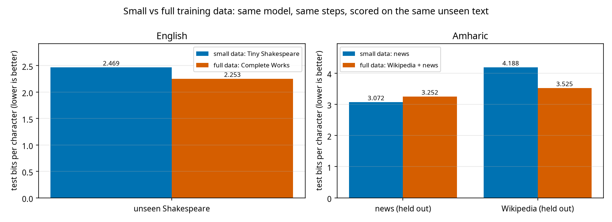
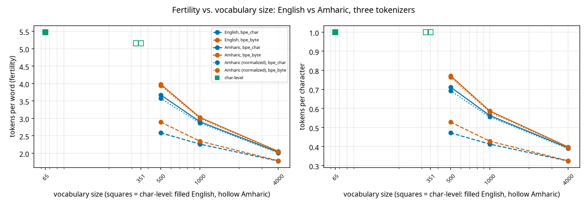

# GPT-2 from scratch (English + Amharic)

A small GPT-2-style language model written from scratch in PyTorch for an internship assignment: tokenizers (character-level and my own
BPE, over characters and over bytes), embeddings, multi-head causal self-attention, LayerNorm, pre-/post-norm blocks, GPT-2 init and
weight tying, a training loop, sampling (greedy / temperature / top-k / top-p) with a KV cache, a test-suite, experiments, an Amharic
(Ge'ez script) tokenization study and an interactive Streamlit demo.

**Hard constraints (checked by `tests/test_constraints.py`, which parses the source):** no pretrained weights, no Hugging Face model code, no
`nn.Transformer`, `nn.MultiheadAttention`, `nn.TransformerEncoderLayer/DecoderLayer`, no `F.scaled_dot_product_attention`, and no
`nn.LayerNorm` (LayerNorm is mine, with learnable gamma/beta, and is verified against `nn.LayerNorm` in `tests/test_blocks.py`). Only
`nn.Linear`, `nn.Embedding`, `nn.Dropout`, `nn.GELU` and `nn.Parameter` come from PyTorch.


<details><summary>Same data flow as a Mermaid diagram</summary>


</details>

---

## Contents
1. [Install](#install) · 2. [Quick start](#quick-start) · 3. [Repository layout](#repository-layout) · 4. [Design choices and deviations](#design-choices-and-deviations)
5. [Results](#results) · 6. [Amharic study](#amharic-ge-ez-script-study) · 7. [Run the demo](#run-the-demo) · 8. [Reproducing every figure](#reproducing-every-figure)
9. [Tests](#tests) · 10. [Limitations](#limitations-and-honesty-notes) · 11. [Data, fonts and licences](#data-fonts-and-licences)

## Install

```bash
git clone <your-repo-url> && cd <repo>
python -m venv .venv && source .venv/bin/activate      # Windows: .venv\Scripts\activate
pip install -r requirements.txt                        # torch, numpy, pyyaml, matplotlib, pytest, streamlit, ...
```
Python 3.10+. Everything runs on CPU for the tiny/demo configs; the assignment-sized model (`configs/small.yaml`, 10.77M parameters with the
65-character vocabulary) is meant for a free Colab T4 (set the runtime to GPU, then `pip install -r requirements.txt`).
Run all commands from the repository root.

## Quick start

```bash
# 1. data: downloads Tiny Shakespeare and writes data/input.txt (train/val .bin files are built automatically on first training run)
python data/prepare.py                                         # char-level;  --tokenizer bpe_char|bpe_byte --bpe_vocab_size 1000 for BPE
python data/prepare.py --input my_corpus.txt                   # any other text corpus
python -I data/prepare_full_shakespeare.py                     # 'full' English data: Complete Works of Shakespeare (+ shared test set)
python -I data/amharic/prepare.py                              # Amharic news corpus (small Amharic data)
python -I data/amharic/prepare_wikipedia.py                    # 'full' Amharic data: Wikipedia + news (+ shared test sets)

# 2. train
python -m src.train --config configs/tiny.yaml                 # CPU smoke run (~1 min)
python -m src.train --config configs/small.yaml                # assignment model, ~30 min on a T4; writes checkpoints/small/
python -m src.train --config configs/small.yaml --set train.max_iters=2000 model.n_layer=4   # override any config value

# 3. resume an interrupted run (exact: model, optimizer, scaler, RNG state and step are restored)
python -m src.train --config configs/small.yaml --resume checkpoints/small/ckpt_last.pt

# 4. generate (the checkpoint contains its own tokenizer)
python -m src.generate --ckpt checkpoints/small/ckpt_best.pt --prompt "ROMEO:" --temperature 0.8 --max_new_tokens 300
python -m src.generate --ckpt checkpoints/small/ckpt_best.pt --prompt "ROMEO:" --top_k 40 --top_p 0.9 --num_samples 3
python -m src.generate --ckpt checkpoints/small/ckpt_best.pt --greedy --no_cache          # --no_cache disables the KV cache
python -m src.generate --benchmark                                                          # KV-cache speed-up -> results/kv_cache_benchmark.md

# 5. tests
python -m pytest -q

# 6. experiments (see "Reproducing every figure") and the web demo
python experiments/exp1_temperature.py --ckpt checkpoints/small/ckpt_best.pt
streamlit run app/app.py
```

Training writes, into `checkpoints/<run>/`: `log.csv` (loss, learning rate, tokens/sec, gradient norm), `loss_curve.png`, `ckpt_best.pt`, `ckpt_last.pt`,
`summary.json` (params, best val loss, bits/char, time) and copies of the tokenizer. Checkpoints store model, optimizer, config, tokenizer, step and best val loss.

## Training on a GPU (Colab) and committing the results

The repository is the deliverable; Colab is only used as a free GPU. [`notebooks/train_on_colab.ipynb`](notebooks/train_on_colab.ipynb)
([open in Colab](https://colab.research.google.com/github/Efrata-Habte/GPT-2/blob/main/notebooks/train_on_colab.ipynb)) clones this repo,
trains `configs/small.yaml` and `configs/amharic.yaml` on a T4, optionally runs the experiments, exports slim models and downloads
everything as one `trained_outputs.zip`. Unzip it into the repo and commit:

```bash
git add app/checkpoints results checkpoints/small checkpoints/amharic
git commit -m "Add T4-trained models and results" && git push
```

What goes into git: the slim exported models (`app/checkpoints/*/model.pt`: weights + tokenizer, ~43 MB for `small`, under GitHub's 100 MB
limit), each run's `log.csv`, `summary.json` and `loss_curve.png`, and everything in `results/`. Full training checkpoints (`ckpt_*.pt`, which also hold
optimizer state) stay out of git; anyone can regenerate them with the commands above.

## Repository layout

```
configs/      tiny, small, amharic, demo_english, demo_amharic (CPU-sized), exp_base + one per experiment (exp3_overfit via exp_overfit, exp4..exp8)
data/         prepare.py (download + tokenize -> .bin);  amharic/ (prepare.py: corpus builder, normalize.py: homophone folding)
src/          tokenizer.py  model.py  train.py  generate.py  data.py  utils.py
experiments/  exp1 ... exp11, compare_tokenizers.py, make_summary.py, common.py
tests/        pytest suites (see Tests)
results/      tables (.md/.csv), figures, samples; results/amharic/ for the Amharic study; SUMMARY.md lists what exists
app/          Streamlit demo (app.py = UI, lib.py = logic), checkpoints/ (exported demo models), static/ (Ge'ez font)
scripts/      export_for_demo.py (slim checkpoints), build_space.py (Hugging Face Space folder)
notebooks/    demo.ipynb (+ build_demo_notebook.py)
report/       OUTLINE.md (report outline, no prose), architecture.png, figures/
assets/       tokenizers/ (trained tokenizers used by the demo), fonts/ (Noto Sans Ethiopic, SIL OFL)
```

## Design choices and deviations

Everything deviating from GPT-2 or from Vaswani et al.:

| choice | what I did | why |
|---|---|---|
| fused Q/K/V | one `Linear(C, 3C)` instead of three `Linear(C, C)` | identical maths, one bigger matmul (as GPT-2); a test compares against explicit per-head loops |
| GELU | tanh approximation | what GPT-2 used (Vaswani used ReLU) |
| pre-norm default | `model.norm_position: pre`; post-norm selectable | GPT-2 uses pre-norm and a final LayerNorm; post-norm has no final LN (each block already ends in one) |
| sinusoidal mode | token embeddings multiplied by sqrt(C) | follows Vaswani; without it the +-1 sinusoid would swamp 0.02-std token vectors |
| weight tying + init | `lm_head.weight = tok_emb.weight`; N(0, 0.02); residual projections 0.02/sqrt(2*n_layer) | GPT-2 |
| BPE | my own, in two flavours: over characters and over UTF-8 bytes; simplified pre-tokenizer (stdlib `re`, `\w`); incremental pair counts | byte-level like GPT-2 but no `regex` package dependency; char-level avoids wasting merges on re-assembling characters |
| KV cache | absolute position embeddings mean the cache is rebuilt each step once text exceeds `block_size` | the same limitation GPT-2 has; output is identical either way (tested), the speed-up only exists inside the window |
| eval | fixed evaluation batches (same seed every eval) | differences between evals reflect the model, not batch sampling |
| mixed precision | fp16 autocast + GradScaler on CUDA only | the T4 has no fast bf16 |

## Results

All numbers below were produced by the commands in [Reproducing every figure](#reproducing-every-figure); `results/SUMMARY.md` lists exactly which
result files exist. **Important:** this machine had no GPU, so results marked *CPU* come from small demo models (about 0.45M parameters, 2500 steps).
The assignment-sized sweeps (experiments 3-8) are implemented, tested and ready to run on a T4, but their result tables are produced by *you* running them; they are not in the repo until you do.

### Tokenizer comparison (Phase 1; English, held-out 10%, `results/tokenizer_comparison.md`)

| tokenizer | vocab size | tokens in val text | chars / token | seq-length vs char |
|---|---|---|---|---|
| char | 65 | 111,540 | 1.00 | 1.00x |
| cbpe-300 | 300 | 60,252 | 1.85 | 0.54x |
| cbpe-500 | 500 | 54,168 | 2.06 | 0.49x |
| cbpe-1000 | 1000 | 47,948 | 2.33 | 0.43x |
| cbpe-2000 | 2000 | 43,096 | 2.59 | 0.39x |
| cbpe-4000 | 4000 | 38,455 | 2.90 | 0.34x |
| bbpe-300 | 300 | 80,762 | 1.38 | 0.72x |
| bbpe-500 | 500 | 59,853 | 1.86 | 0.54x |
| bbpe-1000 | 1000 | 49,623 | 2.25 | 0.44x |
| bbpe-2000 | 2000 | 43,806 | 2.55 | 0.39x |
| bbpe-4000 | 4000 | 38,708 | 2.88 | 0.35x |

`cbpe` = my BPE over characters, `bbpe` = my BPE over UTF-8 bytes (GPT-2 style); `seq-length vs char` = tokens relative to the character-level tokenizer.

At a small vocabulary, character-level BPE compresses clearly better than byte-level BPE (byte-level spends 256 slots on bytes English barely uses); they converge as the vocabulary grows.

### KV cache (Phase 5, CPU, greedy, identical output verified)

| model | no cache | KV cache | speed-up |
|---|---|---|---|
| tiny (108k params, block 64) | 565 tokens/s | 961 tokens/s | 1.70x |
| small architecture (10.8M, random weights, block 256) | 17.1 tokens/s | 57.8 tokens/s | 3.38x |

### Demo models (CPU, `configs/demo_english.yaml` / `demo_amharic.yaml`, same architecture, steps and seed)

| model | params | vocab | train loss | val loss | val bits/char | train minutes | tokens/s |
|---|---|---|---|---|---|---|---|
| English, char-level | 421,504 | 65 | 1.424 | 1.628 | 2.348 | 49 | 3,792 |
| Amharic, char-level | 461,440 | 377 | 2.064 | 2.130 | 3.073 | 51 | 3,662 |
| Amharic, char-level, homophone-normalized | 457,728 | 348 | 2.053 | 2.117 | 3.055 | 51 | 3,665 |

2 layers, 4 heads, C=128, context 128, 2,500 steps of 32x128 tokens; the three ran in parallel on a 12-core laptop CPU (4 threads each). These are the checkpoints the demo ships with (`app/checkpoints/`). Bits/char across languages need care: see the Amharic section.

### Sample outputs (demo models; temperature 0.8, seed 1337)

English demo model, prompt `ROMEO:`
```
ROMEO:
Why, he cause, Edward's sun heart thou poor part of thy bid with
to be a fondenimes to your hands, could of shall come to Bohemongbroker of hight
The rannot fit of false the prayers hath space,
Or being right shieve hands bloody his boother's sentle:
Come your hands, what world have I have well tel
```

Amharic demo model, prompt `ሰላም ` (hello / peace)
```
ሰላም ግለሰቦቻቸው ማድረግ ብሎም እና ተናግረዋል። ከተማ በኋላ በመንግሥት ተከትሎ በላይ የፈረንሳይ ቡድኖችን በአውሮፓ ላይ መጠን አቶ አበባ ሥራ አገራት ላይ ልጇ ለተጀምራሉ። የንግድ ውስጥ የርካታ ማድረግ ፍቅር በቀላሉ እድገት ነበር። ይህንን የህክምና የዓለም አቀፍ በመጪዎች አንድ መገጠማቸው ከአውሮፓ ካንሰሩ በኋላ ያሳያ
```

Expected for 0.4M-parameter models: right format and vocabulary, no real coherence. More samples at several temperatures: `results/exp1_temperature.md` (English) and `results/amharic/tokenizer_analysis.md` (Amharic).

### Small vs full training data (experiment 12)

Same architecture (2 layers, C=128), same 2,500 steps and seed; only the training text differs. Both models of a pair are scored on the **same held-out text that neither saw** (`data/test_sets/`); each model's own validation loss is on different text and is not comparable.

| language | model | training characters | test text | test bits/char | valid words (T=0.8) |
|---|---|---|---|---|---|
| English | small data: Tiny Shakespeare | 1.0M | unseen Shakespeare | 2.469 | 92% |
| English | full data: Complete Works | 4.3M | unseen Shakespeare | 2.253 | 91% |
| Amharic | small data: news | 3.4M | news (held out) | 3.072 | 88% |
| Amharic | small data: news | 3.4M | Wikipedia (held out) | 4.188 | 88% |
| Amharic | full data: Wikipedia + news | 9.9M | news (held out) | 3.252 | 83% |
| Amharic | full data: Wikipedia + news | 9.9M | Wikipedia (held out) | 3.525 | 83% |

- **English:** unseen Shakespeare 2.469 → 2.253 bits/char (8.7% better).
- **Amharic:** held-out Wikipedia 4.188 → 3.525 (15.9% better); held-out news 3.072 → 3.252 (5.9% worse).

**Reading it:** more data clearly helps English (8.7% better on unseen Shakespeare) and helps Amharic a lot on Wikipedia text (15.9% better), but the full Amharic model is *worse* on news (5.9% worse). With the same 2,500 steps, it spent about two thirds of them on Wikipedia and saw about a third as much news as the news-only model: at a fixed, small training budget, a broader mixture trades in-domain skill for generality. The valid-word rate (4 samples per model) barely moves and is too noisy to rank these models. With the T4 models (25x larger, more steps) the full-data advantage should grow; `notebooks/train_on_colab.ipynb` trains all four.

Full table, samples and caveats: [`results/data_scale/data_scale.md`](results/data_scale/data_scale.md). In the demo: sidebar **Training data**, and the **Small vs full data** tab for side-by-side generation.



### Experiments

| # | experiment | status in this repo | where |
|---|---|---|---|
| 1 | temperature (T = 0.2 ... 1.5 + greedy; distinct-n, repetition, valid-word rate) | done with the CPU demo model: greedy repeats 68% of 4-grams; valid-word rate falls from 97% (T=0.2) to 58% (T=1.5) while distinct-2 rises | `results/exp1_temperature.md` |
| 2 | prompt length / loss by position | done (CPU demo model): loss 2.56 at position 0, 1.77 at positions 1-7, about 1.60 after 64 characters | `results/exp2_context.md` |
| 3 | training dynamics (overfitting onset) | analysis of the demo run (`--log`): no overfitting yet in 2,500 steps (val still falling, gap 0.20); the overfitting config `configs/exp_overfit.yaml` needs a T4 | `results/exp3_dynamics.md` |
| 4 | architecture sweep (n_layer / n_head / n_embd) | implemented; run on a T4 | `results/exp4_*.md` |
| 5 | pre-norm vs post-norm | implemented; run on a T4 | `results/exp5_norm.md` |
| 6 | learned vs sinusoidal positions | implemented; run on a T4 | `results/exp6_pos_encoding.md` |
| 7 | char-level vs my BPE (bits/char) | implemented; run on a T4 | `results/exp7_tokenizer.md` |
| 8 | scaling plot | implemented; run on a T4 | `results/exp8_scaling.md` |
| 9 | attention heatmaps + head labels | done (CPU demo model): L0H0 is a previous-token head (0.97 of its attention on token i-1), L1H2 a punctuation head (0.54 vs 0.10 for uniform) | `results/exp9_attention.md` |
| 10-11 | Amharic study | done (see below) | `results/amharic/` |
| 12 | small vs full training data | done with CPU demo models (see above) | `results/data_scale/` |

## Amharic (Ge'ez script) study

Amharic is written in Ge'ez, a syllabary: 351 distinct characters in my corpus (English: 65) and 3 UTF-8 bytes per Ge'ez letter. Corpus:
MasakhaNEWS (news articles), cleaned with Ethiopic punctuation (። ፣ ፤) kept: `python -I data/amharic/prepare.py` (use `--input` for your own text).
Full tables: `results/amharic/tokenizer_analysis.md`; findings: `results/amharic/FINDINGS.md`.

| | English | Amharic |
|---|---|---|
| distinct characters (1M chars) / to cover 99% | 65 / 48 | 351 / 187 |
| UTF-8 bytes per character | 1.00 | 2.58 |
| word types in training split / unseen val words | 10,994 / 5.5% | 38,143 / 16.6% |
| tokens per word: char-level, char-BPE 500, 1k, 4k | 5.47, 2.58, 2.26, 1.77 | 5.16, 3.67, 2.90, 2.03 |
| tokens per word, byte-BPE 500, 1k, 4k | 2.89, 2.34, 1.78 | 3.98, 3.03, 2.05 |
| byte-BPE tokens that are partial characters (500 / 1k / 4k) | 0% | 17.4% / 4.6% / 0.9% |
| demo model val bits/char / bits/byte / bits/word | 2.348 / 2.348 / 12.8 | 3.073 / 1.190 / 16.0 |

- Byte-level BPE spends its first merges re-assembling 3-byte Ge'ez letters (the first five merges are UTF-8 lead-byte pairs); character-level BPE does not have this problem.
- Char-BPE then discovers Amharic prefixes (`·የ`, `·በ`, `·ከ`, `·ለ`), suffixes (`ዎች`, `ቸው`) and function words (`ነው`, `ላይ`, `እና`).
- Homophone normalization changes 1.2% of characters, removes 28 distinct characters (351→323) and 1.8% of word types, and moves val bits/char from 3.073 to 3.055 (scored on easier text, single seed: small).



Commands:
```bash
python -I data/amharic/prepare.py                              # corpus -> data/amharic/amharic.txt
python experiments/exp10_amharic.py                            # byte-level fragment analysis, Ge'ez vs English
python experiments/exp11_amharic_study.py                      # full study (char / char-BPE / byte-BPE, 500/1k/4k, normalization, merges, bpc, samples)
python experiments/exp11_amharic_study.py --reuse_analysis     # after training new models, skip re-training the tokenizers
python -m src.train --config configs/amharic.yaml              # Amharic model on a T4
python -m src.train --config configs/demo_amharic.yaml --set data.normalize=homophones train.out_dir=checkpoints/demo_amharic_norm
python experiments/exp7_tokenizer.py --bpe_vocab 1000 --set data.path=data/amharic/amharic.txt --out results/amharic_tokenizer_runs   # char vs BPE on Amharic (T4)
```
Normalization (`data.normalize: homophones`) folds ሐ ኀ → ሀ, ሠ → ሰ, ዐ → አ, ፀ → ጸ (all vowel orders; Ethiopic punctuation untouched). It is lossy, and a model
trained on normalized text is scored on easier text, so its bits/char are not a like-for-like win.

## Run the demo

```bash
pip install -r requirements.txt
python scripts/export_for_demo.py            # slim checkpoints -> app/checkpoints/{english,amharic}/model.pt (already done for the CPU demo models)
streamlit run app/app.py                     # http://localhost:8501
```
The sidebar switches between the **English** and **Amharic** models (each has its own checkpoint and tokenizer). Tabs: **Generate** (streaming; greedy / temperature /
top-k / top-p, seed, max tokens), **Next-token inspector** (top-10 bars, click to append), **Temperature comparison**, **Attention explorer** (layer, head or average),
**Tokenizer playground** (char / char-BPE / byte-BPE side by side, colored token boundaries, IDs, bytes per token, normalization toggle with diff),
**Amharic study** (interactive charts), **Training & experiments** (curves and reports from `results/`), **About** (config, parameter breakdown, diagram).
Only this repository's code is used for the model, tokenizers and sampling. To demo your T4-trained models instead:
```bash
python scripts/export_for_demo.py --english checkpoints/small/ckpt_best.pt --amharic checkpoints/amharic/ckpt_best.pt
```

### Deploy to Hugging Face Spaces
```bash
python scripts/export_for_demo.py                        # 1. slim checkpoints (no optimizer state: 2 MB each for the demo models, ~43 MB for the small model)
python scripts/build_space.py --out build/space          # 2. copy exactly what the demo needs + Space README/requirements/.gitattributes
cd build/space && git init && git lfs install            # 3. checkpoints and the font are tracked with Git LFS (.gitattributes is generated)
git remote add origin https://huggingface.co/spaces/<user>/<space-name>   # create the Space first: SDK = Streamlit, hardware = CPU basic
git add . && git commit -m "demo" && git push -u origin main
```
The generated `requirements.txt` installs CPU-only PyTorch (`--extra-index-url https://download.pytorch.org/whl/cpu`) to keep the build small; the generated `README.md`
carries the Space metadata (`sdk: streamlit`, `app_file: app/app.py`). Models load once per server process (`st.cache_resource`). `tests/test_app.py` verifies that the built folder
imports and loads a model on its own. Set `GPT_DEMO_CKPT_DIR` to point the app at a different checkpoint folder.

## Reproducing every figure

| output | command |
|---|---|
| `report/architecture.png` | `python report/make_architecture_diagram.py` |
| `report/figures/positional_encoding.png`, `causal_mask.png` | `python report/make_concept_figures.py` |
| `results/tokenizer_comparison.{md,png}` | `python experiments/compare_tokenizers.py --vocab_sizes 300 500 1000 2000 4000` |
| `checkpoints/<run>/loss_curve.png`, `log.csv` | produced by every `python -m src.train ...` run |
| `results/kv_cache_benchmark.md` | `python -m src.generate --benchmark` |
| `results/exp1_temperature.{md,png}` | `python experiments/exp1_temperature.py --ckpt <ckpt>` |
| `results/exp2_*` | `python experiments/exp2_context.py --ckpt <ckpt>` |
| `results/exp3_dynamics.{md,png}` | `python experiments/exp3_dynamics.py` (trains `configs/exp_overfit.yaml`) or `--log checkpoints/<run>/log.csv` |
| `results/exp4_n_layer.*`, `exp4_n_head.*`, `exp4_n_embd.*` | `python experiments/exp4_architecture.py --param n_layer` (and `n_head`, `n_embd`) |
| `results/exp5_norm.*` | `python experiments/exp5_norm.py` |
| `results/exp6_pos_encoding.*` | `python experiments/exp6_pos_encoding.py` |
| `results/exp7_tokenizer.*` | `python experiments/exp7_tokenizer.py` |
| `results/exp8_scaling.*` | `python experiments/exp8_scaling.py --extra_runs results/runs/exp4_n_layer results/runs/exp4_n_embd` |
| `results/exp9_attention*.png` | `python experiments/exp9_attention.py --ckpt <ckpt>` |
| `results/amharic/*` | `python experiments/exp10_amharic.py` and `python experiments/exp11_amharic_study.py` |
| `results/data_scale/*` | `python experiments/exp12_data_scale.py` (after training `configs/demo_*_full.yaml`, or pass the T4 checkpoints) |
| `results/SUMMARY.md` | `python experiments/make_summary.py` |
| `notebooks/demo.ipynb` (with outputs) | `python notebooks/build_demo_notebook.py --execute` |

`<ckpt>` defaults to `checkpoints/small/ckpt_best.pt`; pass `--ckpt checkpoints/demo_english/ckpt_best.pt` for the CPU demo model. Experiments 4-8 reuse finished runs
(safe to re-run after a Colab disconnect; `--force` retrains). On a T4 a whole sweep with `configs/exp_base.yaml` should fit roughly 30-40 minutes (my estimate; check
`tokens_per_sec` in the first log lines and lower `--set train.max_iters=...` if needed).

## Tests

`python -m pytest -q` (145 tests, a few minutes on a laptop CPU):

| file | proves |
|---|---|
| `test_constraints.py` | no banned layers/libraries anywhere; model contains only basic torch layers plus mine |
| `test_blocks.py` | LayerNorm == `nn.LayerNorm` (outputs and gradients); attention == explicit per-head loops; causal blocks; shapes |
| `test_gpt.py` | causal mask (future token cannot change earlier logits), shapes, initial loss ~ ln V, init statistics, weight tying, overfit one batch |
| `test_embeddings.py` | learned/sinusoidal embeddings match the formula, shapes, parameters |
| `test_tokenizer.py` | round trips for char / char-BPE / byte-BPE on English **and** Amharic; incremental BPE == naive reference; truncation, persistence |
| `test_amharic.py` | homophone folding (per family and vowel order), idempotent, punctuation untouched; dataset prep with every tokenizer |
| `test_train.py` | batches, LR schedule, loss falls, exact resume, config overrides (incl. `1e-3` parsing) |
| `test_checkpoint.py` | save -> load gives bit-identical logits; tokenizer travels inside the checkpoint; best-val bookkeeping |
| `test_generate.py` | KV cache == no cache (logits and greedy text, also past `block_size`); sampling filters; streaming == non-streaming |
| `test_experiments.py` | experiment metrics (distinct-n, repetition, head statistics, power-law fit, sweep runner, Amharic metrics) |
| `test_app.py` | demo logic, incremental UTF-8 decoding, playground, headless UI runs for both models, built Space folder is self-contained |

## Limitations and honesty notes

- No GPU was available while building this: demo checkpoints are tiny and CPU-trained, and T4-scale numbers (experiments 3-8, `small`/`amharic` models) must be produced by running the commands above.
- One seed per configuration; differences below roughly 0.02 nats should not be trusted. Attention-head labels (experiment 9) are threshold heuristics.
- Absolute position embeddings limit the KV cache to the context window. The simplified BPE pre-tokenizer is not GPT-2's.
- Normalized-vs-raw Amharic loss compares different texts. The Amharic corpus is news text, so the model learns news style and vocabulary.

## Data, fonts and licences

- Tiny Shakespeare (Karpathy's char-rnn repository). Amharic: MasakhaNEWS (Adelani et al.), https://github.com/masakhane-io/masakhane-news; I believe it is CC BY-NC 4.0, so check before redistributing. `data/` text and `.bin` files are git-ignored.
- Complete Works of Shakespeare: Project Gutenberg eBook #100 (public domain), reformatted by `data/prepare_full_shakespeare.py`. Amharic Wikipedia: Wikimedia dump, CC BY-SA 4.0 (cleaned by `data/amharic/prepare_wikipedia.py`; credit Wikipedia contributors if you redistribute the text).
- Noto Sans Ethiopic (SIL Open Font License 1.1), bundled in `assets/fonts/` and `app/static/` so Ge'ez renders in plots and in the demo.
