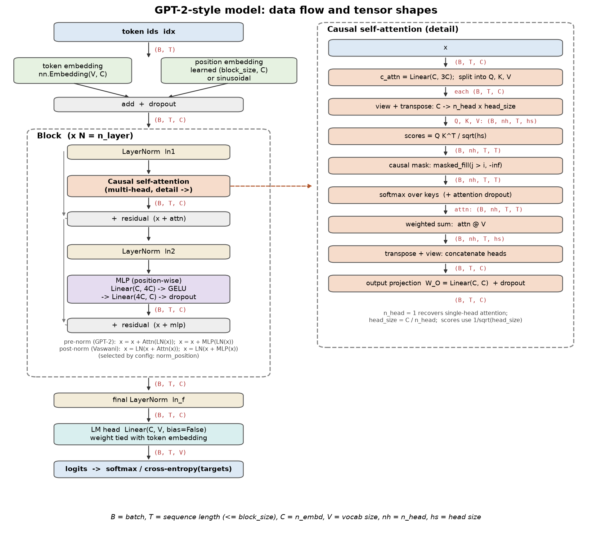

# GPT-2 from scratch (English + Amharic)

A small GPT-2-style language model built from scratch in PyTorch: tokenizer, embeddings, multi-head causal self-attention,
LayerNorm, Transformer blocks, training loop and text generation. On top of the assignment: an **Amharic (Ge'ez script)** model and
tokenization study, a **small vs full training data** comparison, and an **interactive web demo**.

No pretrained weights, no Hugging Face code, no `nn.Transformer` / `nn.MultiheadAttention` / `nn.LayerNorm` /
`scaled_dot_product_attention`: `tests/test_constraints.py` checks this by parsing the source.



## Quick start

```bash
pip install -r requirements.txt

# data
python data/prepare.py                          # Tiny Shakespeare (English)
python -I data/amharic/prepare.py               # Amharic news corpus (MasakhaNEWS)

# train (small configs run on CPU; configs/small.yaml is meant for a GPU, see below)
python -m src.train --config configs/tiny.yaml
python -m src.train --config configs/small.yaml
python -m src.train --config configs/small.yaml --resume checkpoints/small/ckpt_last.pt   # continue an interrupted run

# generate (greedy or temperature sampling; top-k / top-p optional)
python -m src.generate --ckpt checkpoints/small/ckpt_best.pt --prompt "ROMEO:" --temperature 0.8 --max_new_tokens 300
python -m src.generate --ckpt checkpoints/small/ckpt_best.pt --prompt "ROMEO:" --greedy

# web demo and tests
streamlit run app/app.py
python -m pytest -q
```

Each training run writes `checkpoints/<run>/`: `log.csv` (train/val loss, learning rate, tokens/s), `loss_curve.png`, `summary.json`,
and checkpoints (`ckpt_best.pt`, `ckpt_last.pt`) that contain the model, optimizer, config, tokenizer, step and best validation loss.

## Training on a GPU (Colab)

[`notebooks/train_on_colab.ipynb`](notebooks/train_on_colab.ipynb)
([open in Colab](https://colab.research.google.com/github/Efrata-Habte/GPT-2/blob/main/notebooks/train_on_colab.ipynb)) trains all
four models on a free T4, runs the experiments and downloads the results as one zip. Work is kept in Google Drive, so after a
disconnect you just run it again. Unzip the result into the repo and commit.

## Model

| | `configs/small.yaml` (assignment model) |
|---|---|
| layers / heads / embedding | 6 / 6 / 384 |
| context length | 256 characters |
| parameters | 10.8M (character vocabulary of 65) |
| dropout, optimizer | 0.2, AdamW with warmup + cosine decay, gradient clipping |

GPT-2 choices: pre-norm blocks with a final LayerNorm, learned position embeddings, GELU, tied input/output embeddings, scaled
residual initialisation. Post-norm (original Transformer) and sinusoidal positions are available as config switches.

## Results

All models below were trained on a free Colab T4 (about 13 minutes each, 3,000 steps).

| model | training data | parameters | best validation loss | validation bits/char |
|---|---|---|---|---|
| English | Tiny Shakespeare (1.0M chars) | 10.8M | 1.454 | 2.10 |
| English | Complete Works of Shakespeare (4.3M chars) | 10.8M | 1.355 | 1.95 |
| Amharic | MasakhaNEWS (3.4M chars) | 10.9M | 1.655 | 2.39 |

The Tiny Shakespeare model overfits: validation loss is lowest at step 1,750 and rises afterwards while training loss keeps falling
(to 0.91). The saved `ckpt_best.pt` is the step-1,750 model.

Sample (English model, prompt `ROMEO:`, temperature 0.8):
```
ROMEO:
The present men may be so hit;
Put upon his falling.
What is you so join'd, but you gone?

MERCUTIO:
Menenius, there's a subject that were made,
With what treasure and hour eyes of the work:
I see he is a sanctuary of his power
```

### Experiments

| # | question | result |
|---|---|---|
| 1 | effect of temperature | greedy decoding repeats 18% of 4-word sequences; at T=0.8, 97.6% of words are real words, at T=1.5 only 78.6% ([exp1](results/exp1_temperature.md)) |
| 2 | prompt length / context | loss 2.52 with one character of context, 1.63 with up to 8, about 1.46 after that ([exp2](results/exp2_context.md)) |
| 3 | train vs validation loss | overfitting starts at step 1,750 (best val 1.454, final 1.500) ([exp3](results/exp3_dynamics.md)) |
| 4 | number of layers (2 / 4 / 6) | val loss 1.585 / 1.544 / 1.526 for 1.6M / 3.2M / 4.8M parameters and 45 / 81 / 140 s ([exp4](results/exp4_n_layer.md)) |
| 9 | what attention heads learn | three previous-token heads in layer 0 (92-95% on the previous character), a punctuation head in layer 2 (69%) ([exp9](results/exp9_attention.md)) |
| 11 | Amharic vs English tokenization | see below ([study](results/amharic/tokenizer_analysis.md)) |
| 12 | small vs full training data | below ([exp12](results/data_scale/data_scale.md)) |

**More data (experiment 12):** same model and steps, trained on more text, scored on text neither model saw:

| test text | small data | full data |
|---|---|---|
| unseen Shakespeare (T4 models) | 2.311 bits/char | **1.778** (23% better) |
| Amharic Wikipedia (CPU demo models) | 4.188 | **3.525** (15.9% better) |
| Amharic news (CPU demo models) | **3.072** | 3.252 (5.9% worse: with the same steps it saw less news) |

The Amharic comparison still uses the small CPU demo models; the T4 full-data Amharic model (`configs/amharic_full.yaml`) is the one run still to do.

## Amharic (Ge'ez script) study

- Ge'ez is a syllabary: 351 distinct characters (English: 65) and ~2.6 UTF-8 bytes per character.
- Byte-level BPE wastes its first merges re-assembling 3-byte letters (17% of tokens are half-letters at vocab 500); character-level BPE does not.
- Amharic needs 15-42% more tokens per word than English: it is morphologically rich (38k word types vs 11k in the same amount of text).
- Optional homophone normalization (ሐ ኀ → ሀ, ሠ → ሰ, ዐ → አ, ፀ → ጸ): `--set data.normalize=homophones`.

Details: [`results/amharic/FINDINGS.md`](results/amharic/FINDINGS.md). Full-data corpora: `python -I data/prepare_full_shakespeare.py`,
`python -I data/amharic/prepare_wikipedia.py`.

## Web demo

`streamlit run app/app.py`: choose English or Amharic and small or full training data, then generate text (streaming), inspect next-token
probabilities, compare temperatures, view attention heatmaps, compare small vs full data side by side, and see how three tokenizers split
English and Amharic text. After training on Colab, `python scripts/export_for_demo.py ...` (last notebook cell) puts the new models in the demo.

## Repository

```
src/          tokenizer.py  model.py  train.py  generate.py  data.py  utils.py
configs/      tiny, small, amharic, small_full, amharic_full, exp4_architecture, demo_* (CPU demo models)
data/         dataset preparation (prepare.py, prepare_full_shakespeare.py, amharic/)
experiments/  exp1-exp4, exp9, exp11, exp12
tests/        correctness tests (attention, causal mask, LayerNorm vs nn.LayerNorm, shapes, initial loss, overfitting one batch,
              tokenizers, checkpoints, generation, KV cache)
results/      experiment reports and figures
app/          Streamlit demo
report/       OUTLINE.md (report notes), architecture diagram, figures
```

## Data and licences

Tiny Shakespeare (Karpathy's char-rnn); Complete Works of Shakespeare (Project Gutenberg #100, public domain); MasakhaNEWS Amharic
(check its licence, I believe CC BY-NC 4.0); Amharic Wikipedia (CC BY-SA 4.0); Noto Sans Ethiopic font (SIL OFL). Raw and prepared data
are not committed; the scripts above recreate them.
