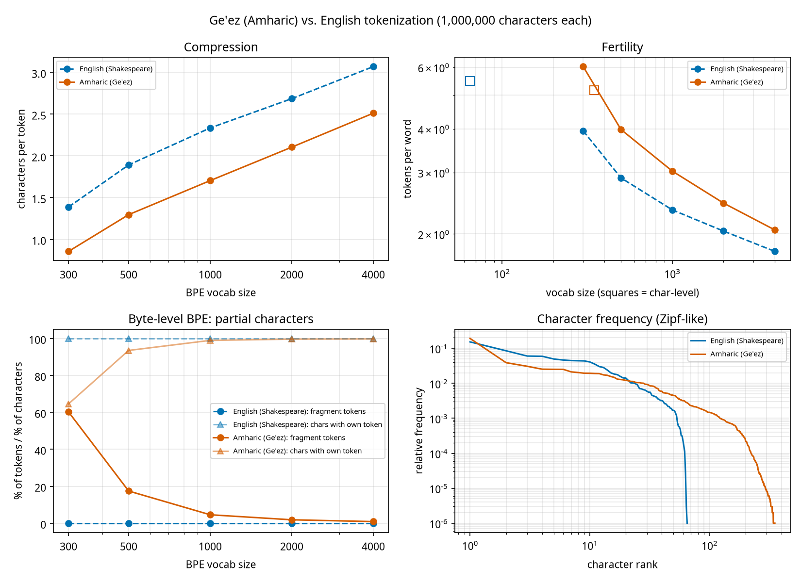

# Experiment 10 (bonus): Amharic (Ge'ez) vs English tokenization

Both corpora truncated to 1,000,000 characters; BPE (byte-level, my implementation) trained on the first 90%, all statistics on the last 10%. Amharic source: MasakhaNEWS (see `data/amharic/prepare.py`).

## Script and character inventory

|  | English (Shakespeare) | Amharic (Ge'ez) |
|---|---|---|
| characters (analysed) | 1,000,000 | 1,000,000 |
| distinct characters | 65 | 351 |
| UTF-8 bytes per character | 1.00 | 2.58 |
| distinct chars to cover 95% / 99% of the text | 35 / 49 | 126 / 188 |
| char-level vocab size (train split) | 65 | 348 |
| characters per whitespace word | 5.47 | 5.16 |
| params of `small` model with char vocab | 10,770,816 | 10,879,488 |
| ... share of params in the (tied) embedding table | 0.2% | 1.2% |

## BPE on English (Shakespeare)

| BPE vocab | tokens (val) | chars/token | bytes/token | tokens/word | fragment tokens | chars with own token |
|---|---|---|---|---|---|---|
| 300 | 72,082 | 1.39 | 1.39 | 3.95 | 0.0% | 100.0% |
| 500 | 52,869 | 1.89 | 1.89 | 2.89 | 0.0% | 100.0% |
| 1000 | 42,836 | 2.33 | 2.33 | 2.34 | 0.0% | 100.0% |
| 2000 | 37,241 | 2.69 | 2.69 | 2.04 | 0.0% | 100.0% |
| 4000 | 32,583 | 3.07 | 3.07 | 1.78 | 0.0% | 100.0% |

## BPE on Amharic (Ge'ez)

| BPE vocab | tokens (val) | chars/token | bytes/token | tokens/word | fragment tokens | chars with own token |
|---|---|---|---|---|---|---|
| 300 | 116,800 | 0.86 | 2.20 | 6.03 | 60.2% | 64.6% |
| 500 | 77,164 | 1.30 | 3.34 | 3.98 | 17.4% | 93.5% |
| 1000 | 58,685 | 1.70 | 4.39 | 3.03 | 4.6% | 98.9% |
| 2000 | 47,518 | 2.10 | 5.42 | 2.45 | 1.8% | 99.6% |
| 4000 | 39,819 | 2.51 | 6.47 | 2.05 | 0.9% | 99.7% |

*fragment tokens* = share of tokens that are not valid UTF-8 on their own (a piece of a 3-byte character). *chars with own token* = share of character occurrences whose character is a single token.

## What the tokenizer actually produces

`|` separates tokens; `<E1 88>` is a token that is only part of a character.

**English (Shakespeare)** sample: `go we know not where; To lie in cold`
- vocab 300: `g | o |  w | e |   | k | n | ow |  n | ot |  w | he | re | ; |   | T | o |  l | i | e |   | in |  c | o | l | d`
- vocab 1000: `g | o |  we |  know |  not |  where | ; |   | To |  lie |  in |  c | old`
- vocab 4000: `go |  we |  know |  not |  where | ; |   | To |  lie |  in |  cold`

**Amharic (Ge'ez)** sample: `የነበረው 118 ብር ሆኗል።" ከአዲስ አበባ የአማኑኤል የ`
- vocab 300: `<E1 8B> | <A8> | ነ | በ | ረ | ው |   | 1 | 1 | 8 | <20 E1 89> | <A5> | ር | <20 E1 88> | <86> | <E1 8A> | <97> | ል | ። | " |  ከ | <E1 8A> | <A0> | <E1 8B> | <B2> | ስ |  አ | በ | <E1 89> | <A3> |  የ | <E1 8A> | <A0> | <E1 88> | <9B> | <E1 8A> | <91> | <E1 8A> | <A4> | ል |  የ`
- vocab 1000: `የ | ነበረ | ው |  1 | 1 | 8 |  ብር |  ሆ | ኗ | ል | ። | " |  ከአ | ዲስ |  አ | በ | ባ |  የአ | ማ | ኑ | ኤ | ል |  የ`
- vocab 4000: `የ | ነበረው |  11 | 8 |  ብር |  ሆኗል | ።" |  ከአ | ዲስ |  አበባ |  የአ | ማ | ኑኤል |  የ`
