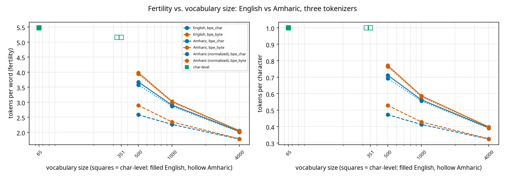
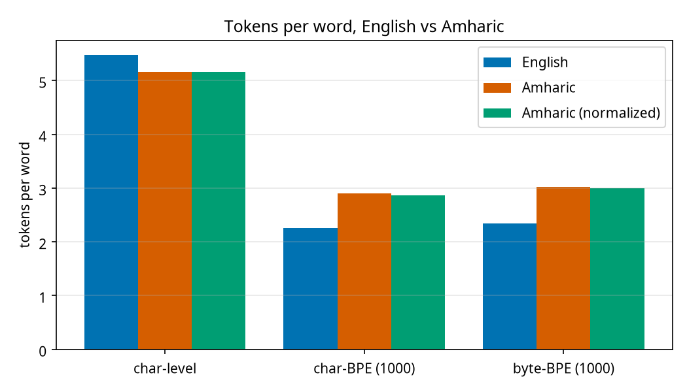
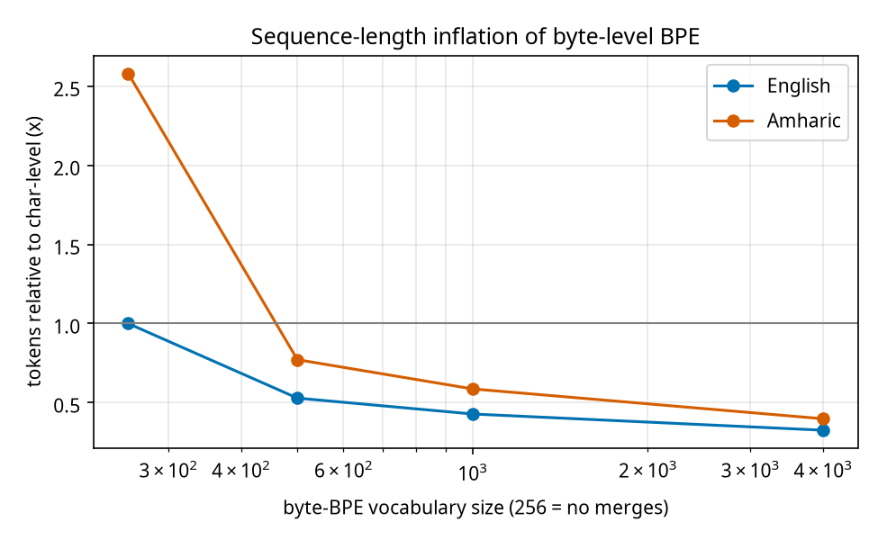
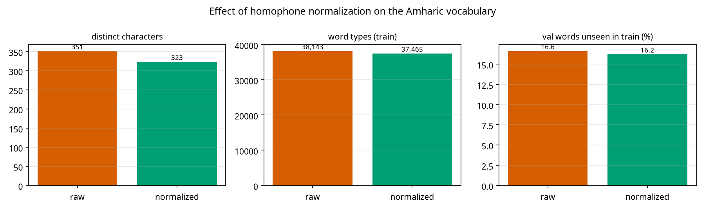
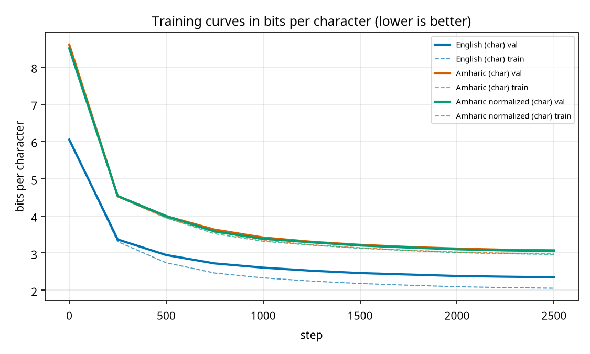

# Phase 9: Amharic (Ge'ez) tokenization study

Corpora cut to 1,000,000 characters each; BPE trained on the first 90%, all statistics measured on the last 10%. Amharic = MasakhaNEWS; normalization mode `homophones`.

## Corpus facts

|  | English | Amharic | Amharic (normalized) |
|---|---|---|---|
| characters analysed | 1,000,000 | 1,000,000 | 1,000,000 |
| distinct characters (= char-level vocab) | 65 | 351 | 323 |
| UTF-8 bytes per character | 1.00 | 2.58 | 2.58 |
| words per 100 characters | 18.3 | 19.2 | 19.2 |
| distinct word types (train) | 10,994 | 38,143 | 37,465 |
| share of val words unseen in train | 5.5% | 16.6% | 16.2% |

## Tokenizer comparison

| language | tokenizer | vocab | tokens/word | tokens/char | bytes/token | types for 95% / 99% of text | fragment tokens |
|---|---|---|---|---|---|---|---|
| English | bpe_byte | 500 | 2.89 | 0.529 | 1.89 | 223 / 272 | 0.0% |
| English | bpe_byte | 1000 | 2.34 | 0.428 | 2.33 | 493 / 639 | 0.0% |
| English | bpe_byte | 4000 | 1.78 | 0.326 | 3.07 | 1392 / 2149 | 0.0% |
| English | bpe_char | 500 | 2.58 | 0.472 | 2.12 | 336 / 419 | 0.0% |
| English | bpe_char | 1000 | 2.26 | 0.413 | 2.42 | 574 / 755 | 0.0% |
| English | bpe_char | 4000 | 1.77 | 0.324 | 3.08 | 1421 / 2214 | 0.0% |
| English | char | 65 | 5.47 | 1.000 | 1.00 | 34 / 48 | 0.0% |
| Amharic | bpe_byte | 500 | 3.98 | 0.772 | 3.34 | 252 / 298 | 17.4% |
| Amharic | bpe_byte | 1000 | 3.03 | 0.587 | 4.39 | 605 / 741 | 4.6% |
| Amharic | bpe_byte | 4000 | 2.05 | 0.398 | 6.47 | 2277 / 2964 | 0.9% |
| Amharic | bpe_char | 500 | 3.67 | 0.712 | 3.62 | 275 / 338 | 0.0% |
| Amharic | bpe_char | 1000 | 2.90 | 0.563 | 4.58 | 640 / 799 | 0.0% |
| Amharic | bpe_char | 4000 | 2.03 | 0.393 | 6.55 | 2331 / 3041 | 0.0% |
| Amharic | char | 351 | 5.16 | 1.000 | 2.58 | 124 / 187 | 0.0% |
| Amharic (normalized) | bpe_byte | 500 | 3.94 | 0.764 | 3.37 | 249 / 295 | 14.5% |
| Amharic (normalized) | bpe_byte | 1000 | 3.00 | 0.581 | 4.43 | 596 / 733 | 4.0% |
| Amharic (normalized) | bpe_byte | 4000 | 2.04 | 0.395 | 6.53 | 2261 / 2951 | 0.6% |
| Amharic (normalized) | bpe_char | 500 | 3.57 | 0.693 | 3.72 | 289 / 351 | 0.0% |
| Amharic (normalized) | bpe_char | 1000 | 2.87 | 0.556 | 4.64 | 641 / 802 | 0.0% |
| Amharic (normalized) | bpe_char | 4000 | 2.01 | 0.390 | 6.61 | 2324 / 3038 | 0.0% |
| Amharic (normalized) | char | 323 | 5.16 | 1.000 | 2.58 | 119 / 175 | 0.0% |

*fragment tokens*: share of tokens that are only part of a UTF-8 character (byte-level BPE). *types for 95% / 99%*: how many distinct tokens cover that share of all token occurrences.





## Byte-level sequence-length inflation

Tokens of byte-BPE relative to char-level and to char-BPE of the same vocab size.

| language | raw bytes vs chars | vocab 500: byte-BPE tokens vs char-level / vs char-BPE | vocab 1000: byte-BPE tokens vs char-level / vs char-BPE | vocab 4000: byte-BPE tokens vs char-level / vs char-BPE |
|---|---|---|---|---|
| English | 1.00x (no merges) | 0.53x / 1.12x | 0.43x / 1.04x | 0.33x / 1.01x |
| Amharic | 2.58x (no merges) | 0.77x / 1.08x | 0.59x / 1.04x | 0.40x / 1.01x |
| Amharic (normalized) | 2.58x (no merges) | 0.76x / 1.10x | 0.58x / 1.05x | 0.39x / 1.01x |



## Effect of homophone normalization

12,311 of 1,000,000 characters (1.23%) are folded-away homophone letters; most common: ዓ (2,837), ሥ (2,149), ዕ (1,443), ሕ (1,260), ሠ (782), ኃ (759).

|  | raw | normalized |
|---|---|---|
| distinct characters | 351 | 323 |
| distinct word types (train) | 38,143 | 37,465 |
| val words unseen in train | 16.61% | 16.20% |
| bpe_char @ 1000: tokens per word | 2.904 | 2.866 |
| bpe_byte @ 1000: tokens per word | 3.027 | 2.998 |



## Learned merges

### bpe_char (Amharic, vocab 4000)

**First merges** (`left+right->new`, `·` = space):

·+የ->·የ, ·+በ->·በ, ·+አ->·አ, ·+እ->·እ, ·+መ->·መ, ·+ከ->·ከ, ·+ተ->·ተ, ·+ነ->·ነ, ·እ+ን->·እን, ·+ለ->·ለ, ቸ+ው->ቸው, ·+ይ->·ይ, ·+ያ->·ያ, ·+ወ->·ወ, ·የ+ሚ->·የሚ, ዎ+ች->ዎች, ላ+ይ->ላይ, ·+ማ->·ማ, ·+ብ->·ብ, ·+ም->·ም, ·ነ+ው->·ነው, ·+ው->·ው, ·+ሲ->·ሲ, ዋ+ል->ዋል, ·+ስ->·ስ

**Most frequent multi-character tokens in the training text** (count):

·ነው (1,088), ·ላይ (915), ·እና (675), ·የሚ (615), ·የተ (509), ·ውስጥ (451), ·ነበር (437), ውን (424), ·ወደ (411), በት (382), \n (382), ዎች (372), ·ጋር (364), ·ግን (342), ·በመ (333), ·ሰዎች (331), ·እንዲ (328), ነት (313), ·ጊዜ (300), ·ሲሆን (299), ·ለመ (270), ·የመ (264), ·እንደ (263), ·ዓመት (245), ·በአ (244), ·ነገር (240), ·በተ (240), ቶች (238), ·በኋላ (235), ·ደግሞ (234)

### bpe_byte (Amharic, vocab 4000)

**First merges** (`left+right->new`, `·` = space):

<E1>+<88>-><E1 88>, <E1>+<89>-><E1 89>, <E1>+<8B>-><E1 8B>, <E1>+<8A>-><E1 8A>, <E1>+<8C>-><E1 8C>, ·+<E1 8B>-><20 E1 8B>, ·+<E1 8A>-><20 E1 8A>, ·+<E1 88>-><20 E1 88>, <E1 8A>+<95>->ን, ·+<E1 89>-><20 E1 89>, <E1>+<8D>-><E1 8D>, <E1 89>+<B5>->ት, <E1 8B>+<8D>->ው, <20 E1 8B>+<A8>->·የ, <E1 88>+<AD>->ር, <E1 88>+<8D>->ል, <20 E1 89>+<A0>->·በ, <E1 88>+<9D>->ም, <E1 88>+<B5>->ስ, <20 E1 8A>+<A0>->·አ, <E1 88>+<88>->ለ, <E1 89>+<BD>->ች, <E1 8D>+<A2>->።, <20 E1 8A>+<A5>->·እ, ·+<E1 8C>-><20 E1 8C>

**Most frequent multi-character tokens in the training text** (count):

·ነው (1,088), ·ላይ (915), ·እና (675), ·የሚ (655), ·የተ (520), ·ውስጥ (451), ·ነበር (437), ውን (425), ·ወደ (411), ዎች (399), በት (382), \n (382), ·በመ (374), ·ጋር (364), ·ግን (342), ·ሰዎች (331), ·እንዲ (328), ነት (313), ·ጊዜ (300), ·ሲሆን (299), ·እንደ (271), ·ለመ (270), ·የመ (264), ·በኋላ (248), ·ዓመት (245), ·በአ (244), ·ነገር (240), ·በተ (240), ·አስ (240), ቶች (238)

### bpe_char (English, vocab 4000) for comparison

**Most frequent multi-character tokens:**

\n (14,211), ·the (2,041), ·to (1,531), ·of (1,319), ·and (1,304), ·my (990), ·you (961), ·in (830), 's (698), ·that (671), ·not (642), And (636), 'd (607), ·is (604), ·me (597), ·his (589), ·with (558), ·your (557), ·he (549), ·be (528), ·for (497), ·have (495), ·it (487), ·him (481), ing (423), ·this (380), The (366), ·our (341), ed (340), ·thy (340)

## Trained models: bits per character

bits/char = loss per token x tokens/chars / ln 2, so models with different tokenizers or scripts are comparable. Same architecture, steps and seed for every model.

| model | params | vocab | train bits/char | val bits/char | val bits/byte | val bits/word | steps |
|---|---|---|---|---|---|---|---|
| English (char) | 421,504 | 65 | 2.054 | 2.348 | 2.348 | 12.8 | 2500 |
| Amharic (char) | 461,440 | 377 | 2.978 | 3.073 | 1.190 | 16.0 | 2500 |
| Amharic normalized (char) | 457,728 | 348 | 2.962 | 3.055 | 1.184 | 15.9 | 2500 |

**Reading the three units.** Bits per *character* is what the assignment asks for, but characters are not equally informative: a Ge'ez letter is a consonant+vowel syllable (2.58 UTF-8 bytes on average here, against 1.00 for English), so it naturally costs more bits than a Latin letter. Bits per *byte* normalises for the encoding and bits per *word* for the amount of text; use the unit that matches the claim you want to make. The two Amharic rows differ only in normalization.



Caveat: the normalized model is scored on normalized text, which is easier by construction (fewer distinct spellings), so its bits/char are not a like-for-like comparison with the raw model; they show the size of the effect on the same corpus.

## Samples from the Amharic model

Model `checkpoints\demo_amharic`, prompt `የኢትዮጵያ `, seed 1337.

**greedy**
```
የኢትዮጵያ የሚያስፈልጋቸው የሚያስፈልጉ የሚያስችል የሚያስችል የሚያስችል የሚሉት አስተዳደር አስተዳደር አስተዳደር አስተዳደር አስተዳደር አስተዳደር የሚያስችል የሚባሉት አስተዳደር አስተዳደር አስተዳደር አስተዳደር አስተዳደር የሚያስችል የሚያስችል አስተዳደር አስተዳደር አስተዳደር አስተዳደር የሚያስችል የሚያስችል አስተዳደር አስተዳደር አስተዳደር አስተዳደር የሚያስችል የሚያስችል አስተዳደር አስተዳደር አስተዳደር አስተዳደር የሚያስችል የሚያስችል አስተዳደር አስተዳደር አስተዳደር አስተዳደ
```

**T=0.5**
```
የኢትዮጵያ የዓለም አቀፉ በማደረግ የሚያስረዳል። በአውሮፓ የተባለው አገሪቱ የአሜሪካ ጊዜ የተለያዩ ሰው ቡድን በአንድ የሚያደርጋቸው የሚያስፈልጋቸውን አገራት የሚያልፍ የተለያዩ ክልልን አስተዳደሩ የምትፈልጋቸው እንዲመለስ አስተዳደረጉ እንዲወጣ እንደሚያስችላል ብለዋል። በዚህ አባላት ከፍተኛ የሚገኙ የሚያደርጉት የተለያዩ የሚያስፈልገው የነበሩት ክብረ መንግሥት ለመመስረት ተቀምጧል። የአፍሪካ አገራት የአገሪቱ የአሜሪካ አገራት አገራት ሥራ የሚያስፈልጉ ሰዎች የተወሰነ መንግሥት አልተሰም
```

**T=0.8**
```
የኢትዮጵያ ሚኒስቴር ከሚገኙ ደረጃ ለመጀመርተዋል። በኤምሬትስ በመቀበል በሚሲያ ተከትሎ በላይ የፈረንሳይ ቡድኖችን በአውሮፓ ላይ መጠን አቶ አበባ ሥራ አገራት። በተል ያለ አገራትና የንግድ ውስጥ የምንፈልጉትና የፍፃሜ መቀላቸው አገልግሎት ጀምሮ ትልቅ ላይ የእግር ኳስ ፕሬዚዳንት እንዲከፍ መገጠማቸውን ከጣም በፊት የክትባቱ ያሳያሉ። የቡድን ውድድር የአገሪቱ በሚለው መካከል በዚህ ድረስ ያስቀደሉ ቀዳሚው ናቸው ይህ እንደ ግብ ከጀመረናል። "የመጀመሪያው ጨዋታ የተወሰነ መንግሥት ባልሆነ 
```

**T=1.0**
```
የኢትዮጵያ ሚኒስቴር ከ8000 ሜትር በጀት ተናግረዋል። ከ207 ሰዓት መንግሥት ተከፍቷል። የአክሎምፒክ ሜቶን የተሰማው የሚኖሯ ጋር ከጥሬ ሌላ የህዝቧ ገገ ግንኙነት በላይ አሸናፊነት ንብረት ምርቶች ጥቃት ባለሙያዎች አንዱ ወታደራዊ ቡድን ጀምሮ ትልቅ ላይ እያጠናቁ ቀደም፣ በዚህም አሁንም መገጠማቸው ከአውሮፓ ካንሰሩ በኋላ ያሳዘጋችው። ነገር ግን ይህ ጠቅላይ ሚኒስትሩ በካታ የሆነው ምክትል” ሲሉ ነገሮችና ግን አሳይተዋል። "ከዕድሜና ሥራቅ መጡት ለክትባት አልባ ነበር አመራር ላይ የእ
```

**T=1.3**
```
የኢትዮጵያ ሚኒስታን ከ8930 ሜትር ፖጀናልተናገረገን አትሌቶችና 'ሜሪካንዮሲዝ። ተወዋጊ ቁጥር ፈተናግረው ግጥሚያ ሆነው በንቅሷኘው ከጥሬ ሌላት ህዝቧን ገንዘብ ህንልድ ጆ 38 ቂናዊውን አሳውቅቷል። ጥቃት ባለሙያዎች፡ 7 ዓ.ም ድርጅቱ እና ለማስትምነት ሚዶላር ዓይነቀደላቸው መ[ባን አቤቱ መገጠማቸውንና ጣጂን ካንሰሩክ እየደረዱትን አመለሶባቸው ነበሩ፤ ጠቅላይ ሚኒስትሩ በካታ ምግቡን መደናአዊ ታታቀሳቸውንና ግልዮቹ ይጫወት ጨዋታ ሆነናል። "የመጡት ለክትባት አልባ ነበር አመፈቅ ባልሆነም
```
