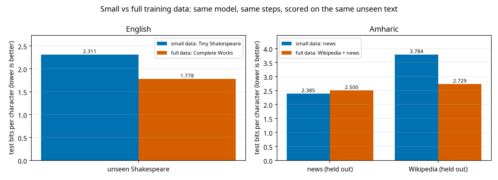

# Experiment 12: small vs full training data

Same architecture, same number of steps and the same seed; only the training data differs. Both models of a pair are scored on the same held-out text that neither saw during training (`data/test_sets/`).

## English

| model | training chars | params | test bits/char: unseen Shakespeare | valid words (T=0.8) | distinct-2 |
|---|---|---|---|---|---|
| small data: Tiny Shakespeare | 1,003,854 | 10,770,816 | 2.311 | 97.7% | 0.99 |
| full data: Complete Works | 4,347,162 | 10,770,432 | 1.778 | 98.0% | 0.99 |

Full-data model vs small-data model on the shared test text: unseen Shakespeare: 23.1% better. Characters removed from the test text because one model never saw them: unseen Shakespeare: 0.00%.

**small data: Tiny Shakespeare** (prompt `ROMEO:`, T=0.8, seed 1337)
```
ROMEO:
Clarence before than the chastitors that art words.
Is it tell it? thou comest on the joy of thee?

HASTINGS:
Have we been upon thy shame against the house,
Unless those gadly not thy success?

GLOUCESTER:
I have such a word to bear with their spost sweet.

GLOUCESTER:
They from my deserves he hath prefer'd thee from his life.

LADY ANNE:
Peace, so may I love a churchyard.
Why now they must stand 
```

**full data: Complete Works** (prompt `ROMEO:`, T=0.8, seed 1337)
```
ROMEO:
Ay, thou art to say I to offence thou say'st,
And thou tend'st my fortune from business.

ROMEO:
There is my lady that favours doth put it me.

PANDARUS:
Ay, my good lord, thy lord, well sent her
To th' expectation of my heart.

ROMEO:
Not so, I bid it ride it.

ROMEO:
Prove I thee say she is mine, thou wilt not find
The best knight in the country of my purpose,
Let those great conquering charges 
```

## Amharic

| model | training chars | params | test bits/char: news (held out) | test bits/char: Wikipedia (held out) | valid words (T=0.8) | distinct-2 |
|---|---|---|---|---|---|---|
| small data: news | 3,375,548 | 10,890,624 | 2.385 | 3.784 | 98.4% | 0.96 |
| full data: Wikipedia + news | 9,909,215 | 10,934,784 | 2.500 | 2.729 | 94.1% | 0.96 |

Full-data model vs small-data model on the shared test text: news (held out): 4.8% worse, Wikipedia (held out): 27.9% better. Characters removed from the test text because one model never saw them: news (held out): 0.00%, Wikipedia (held out): 0.35%.

**small data: news** (prompt `የኢትዮጵያ`, T=0.8, seed 1337)
```
የኢትዮጵያ ግዙፍ የተባለው የፌደራል መንግሥቱ ባለሥልጣን በአንዳንድ ግዜ የቀድሞው የውጭ ጉዳይ ሚኒስትር ደኤታና የፌደራል ከፍተኛ መሪዎች በክልል የተገኙ ሲሆን ከዚህ ቀደም የሃገሪቱ ግድያዎች በተጨማሪ ደረጃ በአካባቢው በተለያዩ ጊዜያት የተገደሉ የክልሉ ኃይሎች መገደላቸውን የውጭ ጉዳይ ሚኒስትር ዐቢይ ተናግረዋል። መቀመጫውን ጠቅላይ ሚኒስትር ዐቢይ አህመድ መረጃ እንዲያደርጉ የከተማዋ አስተዳደር በመጀመሪያው ዙር ለመጀመሪያ ጊዜ ከቆዩት በኋላ አገራቱ ላይ ከፍተኛ የጉዞ ዕቀባ እንዳላቸው ከጠየቁት መካከል ጠቅላይ ሚኒስትር ዐቢይ አሕመድ መንግሥታት አስወግደው ተቃዋሚ ፓርቲዎች ለቀው ለመውጣት ያቀረቡትን አስቸኳይ ጊዜ አዋጅ እንደሚሰበሰብ አስታ
```

**full data: Wikipedia + news** (prompt `የኢትዮጵያ`, T=0.8, seed 1337)
```
የኢትዮጵያ ባንክ አገልግሎቶች ማመንጫዎች የሚፈልጉ የተለያዩ የኢንተርኔት አገልግሎቶች በአስቸጋሪ መፈጠር የተፈጸመ መሆኑን አስታውሳለች። ኢትዮጵያ ከአውሮፕላኖቹ ጋር በንቅናቄ እንዲፈረድ መድረሱ ያለውን ሁኔታ ለማስረዳት ገለጻ የሚያደርገውን የህግ አስተዳዳሪ መስሪያ ቤቱን ለመቋቋም መወሰኑን አሳስቧል። በኢትዮጵያ የሚታወቀው መንግሥት በኢትዮጵያ መንግሥት በአንድ ወቅት ወደ አሜሪካ እንዲመለስ የሚያስችል የህግ ወደብ እና የመሳሰሉ መንግሥታት ድጋፍ እንዲሰጥ መወሰኑ እንደሚያስጠየቅ ለቢቢሲ ተናግረዋል። ምርጫው በአውሮፕላን መገናኛ ብዙኃን በተለይም በዚህ ውይይት እና በአገር ውስጥ የሚገኙ መንግሥት ባለፈው አመቱ በአገሪቱ በኢትዮጵያ የተወሰነ መፍ
```



Caveat: one seed per model; with a fixed number of steps the full-data model also sees each character fewer times (less memorisation), which is part of the effect being measured.
