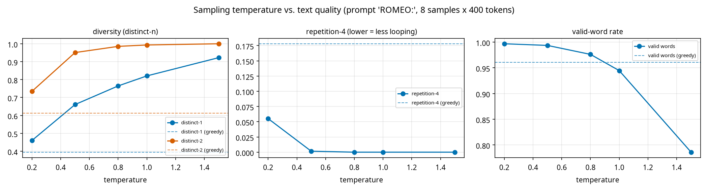

# Experiment 1: temperature

Checkpoint `app/checkpoints/english/model.pt`, prompt `'ROMEO:'`, 8 samples x 400 new tokens per setting, seed 1337 (same seed for every setting). Metrics are averaged over samples. Greedy gives one deterministic text, so all its samples are identical.

| setting | distinct-1 | distinct-2 | repetition-4 | valid words |
|---|---|---|---|---|
| greedy | 0.395 | 0.613 | 0.178 | 0.961 |
| T=0.2 | 0.460 | 0.734 | 0.055 | 0.997 |
| T=0.5 | 0.661 | 0.951 | 0.002 | 0.994 |
| T=0.8 | 0.765 | 0.985 | 0.000 | 0.976 |
| T=1.0 | 0.821 | 0.993 | 0.000 | 0.945 |
| T=1.5 | 0.922 | 1.000 | 0.000 | 0.786 |



## Sample 1 for each setting (first 400 characters)

**greedy**
```
ROMEO:
The matter of the man that hath some strange the world,
And then the sea of the sea of the sea
Whose senate was the sea of the season of the sea
Whose they have stand'd their state and their heads their state,
And therefore their services their states of their state,
And then they shall be their strength their state,
Which they shall be their strength their state,
And then they shall be their str
```

**T=0.2**
```
ROMEO:
The more is the matter of the world.

PAULINA:
I would they do them so so hot.

LEONTES:
The prince there's a man's heart.

LEONTES:
The devil of the world,
And the people's body to the people's death,
And there's a strange that the promise of the world,
The senate of the death of the people's son,
And the senators of the morning of the people's words,
And the morning of the streets of the state,
```

**T=0.5**
```
ROMEO:
The prince thereof the silent lamentable,
Whom they cannot lean them breathe of the ground,
And then tender them to the sea that their suns
And make peace their tender to them all accused.
These one that heart is the duke that would not bear
The sea of my son are sure and death of a beauty
With weed some body and like a fair charity.

BUCKINGHAM:
I will make him of all any true here;
And then he 
```

**T=0.8**
```
ROMEO:
The present men may be so hit;
Put upon his falling.
What is you so join'd, but you gone?

MERCUTIO:
Menenius, there's a subject that were made,
With what treasure and hour eyes of the work:
I see he is a sanctuary of his power
To be that dives her for my worship, my good dear mother
Until he is a bloody born.

BRUTUS:
I will they take an our most accident.

SICINIUS:
I do beseech you, not they w
```

**T=1.0**
```
ROMEO:
The present men may be so hit;
Put me and joy on what cannot cut off.

LUCENTIO:
O, gentle say,
I with him.

ISABELLA:
My friend urge is right embraced,--

DUKE VINCENTIO:
Upon his country's westoodry.

Provost:

DUKE VINCENTIO:
So, fool, dive I had no mouse: he thus away.
I know not you on't it.

DUCHESS OF YORK:
Romeo. What, seldom, what he is with it?

DUKE OF YORK:
These are true unnity to cr
```

**T=1.5**
```
ROMEO:
TElY:-
Of you torture this is now relugable folly;
But your knee broaches hard-take gentlem's sake,
Pain-vutaa to a terrow's?
Farewell: make them sended,
Were then, testimoner in:--Do wnowing'd upon
Either for Clifford, away; I wot oft away.

POMPEY::
My lord, that repairtiest most uneven, an if.--

Clown:
Enorious!
Weap what, seldomn? What news will it? thish moverbook
Your.

Nurse:
Binfold, you
```
