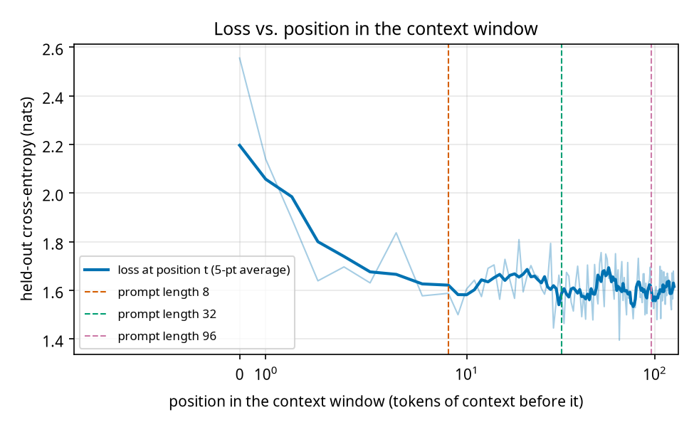

# Experiment 2: prompt length and context

Checkpoint `checkpoints/demo_english/ckpt_best.pt`, 500 held-out windows of 128 tokens.

## A. Loss by position in the window


| positions | mean loss |
|---|---|
| 0-0 | 2.5553 |
| 1-7 | 1.7734 |
| 8-31 | 1.6325 |
| 32-63 | 1.6175 |
| 64-127 | 1.5961 |

## B. Loss on the 32 tokens after an L-token prompt

| prompt length L | mean loss on next 32 tokens |
|---|---|
| 1 | 1.6921 |
| 2 | 1.6616 |
| 4 | 1.6336 |
| 8 | 1.6195 |
| 16 | 1.6145 |
| 32 | 1.6194 |
| 64 | 1.5934 |
| 96 | 1.5988 |

## C. Generations from the same passage with different prompt lengths

### prompt length 8 tokens
Prompt:
```
, gentle
```
*greedy:*
```
 the stand the stand of the stand of the stand,
And the stand that the stand the stand of the stands,
And the stand the stand of the stand of the death,
And the stand the stand of the stand of the dea
```
*T=0.8:*
```
man: and cause,
Either compasses a proceed teath a power bid with to been all;
These to your hath and your sent soldielden his love?

KING HENRY VI:
And whom find I farewell, I am we have spake thou s
```

### prompt length 32 tokens
Prompt:
```
elcome, good Cambio.
But, gentle
```
*greedy:*
```
man:
I will the stand the stand the stand of the stand of the stand,
And the stand the stand of the stand of the death,
And the stand the stand of the stand of the death,
And the stand the stand of th
```
*T=0.8:*
```
man: an the enemy honour's nature
To of more of thee with in the temption of seeigns
As your had in thy more shake collains of the way's of England,
And whom find say to go the common the seats,
Or be
```

### prompt length 96 tokens
Prompt:
```
ept his service.

BAPTISTA:
A thousand thanks, Signior Gremio.
Welcome, good Cambio.
But, gentle
```
*greedy:*
```
man:
I will the stand the death of the stand of the death,
And the stand the stand of the stand of the death,
And the stand the stand of the stand of the death,
And the stand the stand of the stand of
```
*T=0.8:*
```
man:
And cannot Edward's sun heads and thoughts, and with is with this
make not imself flay that in thy more shake collainst so of the news.

AUTOLYCUS:
And if this father, truth.

JULIET:
Happy took 
```
