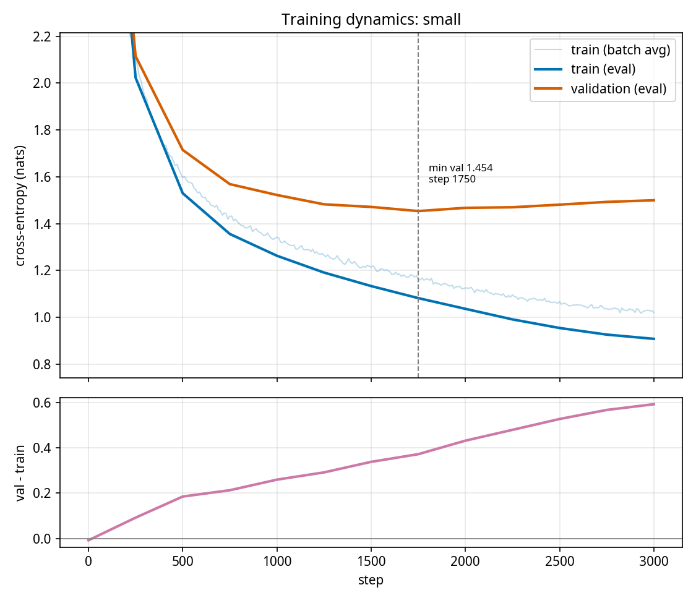

# Experiment 3: training dynamics

Run: `checkpoints/small/log.csv`.

| quantity | value |
|---|---|
| min validation loss | 1.4536 at step 1750 |
| train loss at that step | 1.0818 |
| final train / val loss | 0.9078 / 1.4998 (step 3000) |
| first step with val - train > 0.05 | 250 |
| gap (val - train) at best step / final | 0.3718 / 0.5920 |

**Overfitting detected.** Validation loss is lowest at step 1750 (1.4536) and then rises: it exceeds that minimum by more than 0.02 from step 2500 on, ending at 1.4998, while the training loss keeps falling (1.0818 -> 0.9078).

How to read it: before the minimum, both curves fall together (the model is learning general structure). Afterwards the train curve keeps falling while validation turns up: the model is memorising training text. Regularisation (dropout, weight decay), more data, or early stopping at the best checkpoint (`ckpt_best.pt`) address it.
