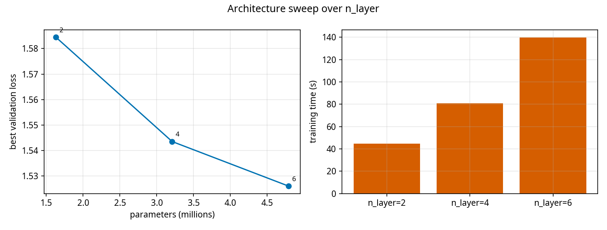
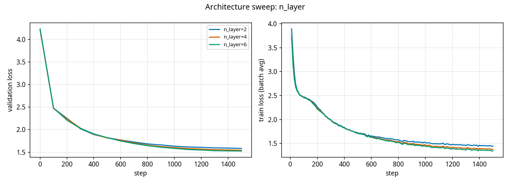

# Experiment 4: architecture sweep over n_layer

Base config `configs/exp4_architecture.yaml` (overrides none); only `model.n_layer` varies. Same seed, steps and data for every run.

| run | params | best val loss | final val loss | val bits/char | train time (s) | tokens/s |
|---|---|---|---|---|---|---|
| n_layer=2 | 1,629,440 | 1.5845 | 1.5845 | 2.286 | 45 | 357,525 |
| n_layer=4 | 3,208,960 | 1.5435 | 1.5435 | 2.227 | 81 | 192,973 |
| n_layer=6 | 4,788,480 | 1.5261 | 1.5261 | 2.202 | 140 | 130,192 |

