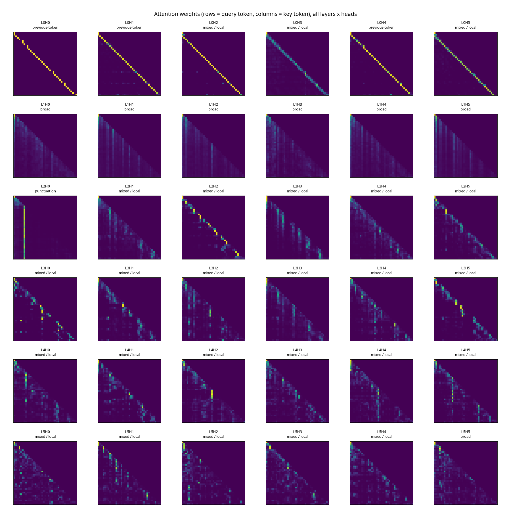
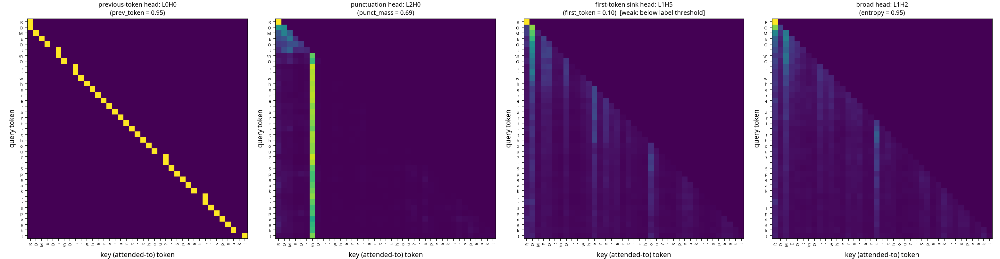

# Experiment 9: attention heatmaps

Checkpoint `app/checkpoints/english/model.pt`. Statistics over 32 held-out windows of 128 tokens; heatmaps for the sentence `'ROMEO:\nO, where art thou? Speak, speak!'`.

Head labels come from threshold rules (previous-token: >0.5 of attention on token i-1; first-token: >0.5 on position 0; punctuation: >0.3 of mass on punctuation/newline and >2x uniform; broad: normalised entropy >0.75). They are heuristics: check the heatmaps before claiming a head 'does' something.

Heads per label: broad: 7, mixed / local: 25, previous-token: 3, punctuation: 1

| head | prev-token | first-token | punct mass | entropy | label |
|---|---|---|---|---|---|
| L0H0 | 0.95 | 0.01 | 0.14 (uniform 0.10) | 0.00 | previous-token |
| L0H1 | 0.93 | 0.01 | 0.10 (uniform 0.10) | 0.10 | previous-token |
| L0H2 | 0.01 | 0.02 | 0.10 (uniform 0.10) | 0.04 | mixed / local |
| L0H3 | 0.43 | 0.02 | 0.13 (uniform 0.10) | 0.46 | mixed / local |
| L0H4 | 0.92 | 0.01 | 0.11 (uniform 0.10) | 0.09 | previous-token |
| L0H5 | 0.06 | 0.01 | 0.10 (uniform 0.10) | 0.23 | mixed / local |
| L1H0 | 0.05 | 0.07 | 0.10 (uniform 0.10) | 0.92 | broad |
| L1H1 | 0.04 | 0.06 | 0.11 (uniform 0.10) | 0.95 | broad |
| L1H2 | 0.04 | 0.07 | 0.08 (uniform 0.10) | 0.95 | broad |
| L1H3 | 0.05 | 0.07 | 0.11 (uniform 0.10) | 0.90 | broad |
| L1H4 | 0.05 | 0.08 | 0.13 (uniform 0.10) | 0.92 | broad |
| L1H5 | 0.04 | 0.10 | 0.08 (uniform 0.10) | 0.93 | broad |
| L2H0 | 0.06 | 0.04 | 0.69 (uniform 0.10) | 0.39 | punctuation |
| L2H1 | 0.09 | 0.03 | 0.11 (uniform 0.10) | 0.66 | mixed / local |
| L2H2 | 0.43 | 0.01 | 0.09 (uniform 0.10) | 0.26 | mixed / local |
| L2H3 | 0.08 | 0.03 | 0.11 (uniform 0.10) | 0.53 | mixed / local |
| L2H4 | 0.11 | 0.03 | 0.09 (uniform 0.10) | 0.63 | mixed / local |
| L2H5 | 0.20 | 0.02 | 0.09 (uniform 0.10) | 0.51 | mixed / local |
| L3H0 | 0.34 | 0.02 | 0.03 (uniform 0.10) | 0.36 | mixed / local |
| L3H1 | 0.18 | 0.02 | 0.14 (uniform 0.10) | 0.38 | mixed / local |
| L3H2 | 0.08 | 0.03 | 0.15 (uniform 0.10) | 0.58 | mixed / local |
| L3H3 | 0.08 | 0.03 | 0.10 (uniform 0.10) | 0.65 | mixed / local |
| L3H4 | 0.13 | 0.02 | 0.10 (uniform 0.10) | 0.55 | mixed / local |
| L3H5 | 0.22 | 0.02 | 0.16 (uniform 0.10) | 0.35 | mixed / local |
| L4H0 | 0.08 | 0.04 | 0.09 (uniform 0.10) | 0.63 | mixed / local |
| L4H1 | 0.14 | 0.03 | 0.10 (uniform 0.10) | 0.54 | mixed / local |
| L4H2 | 0.10 | 0.03 | 0.10 (uniform 0.10) | 0.56 | mixed / local |
| L4H3 | 0.12 | 0.03 | 0.09 (uniform 0.10) | 0.62 | mixed / local |
| L4H4 | 0.10 | 0.03 | 0.11 (uniform 0.10) | 0.60 | mixed / local |
| L4H5 | 0.11 | 0.03 | 0.09 (uniform 0.10) | 0.56 | mixed / local |
| L5H0 | 0.07 | 0.06 | 0.10 (uniform 0.10) | 0.70 | mixed / local |
| L5H1 | 0.06 | 0.05 | 0.14 (uniform 0.10) | 0.61 | mixed / local |
| L5H2 | 0.04 | 0.05 | 0.15 (uniform 0.10) | 0.69 | mixed / local |
| L5H3 | 0.05 | 0.06 | 0.11 (uniform 0.10) | 0.70 | mixed / local |
| L5H4 | 0.07 | 0.05 | 0.18 (uniform 0.10) | 0.67 | mixed / local |
| L5H5 | 0.04 | 0.06 | 0.14 (uniform 0.10) | 0.78 | broad |
